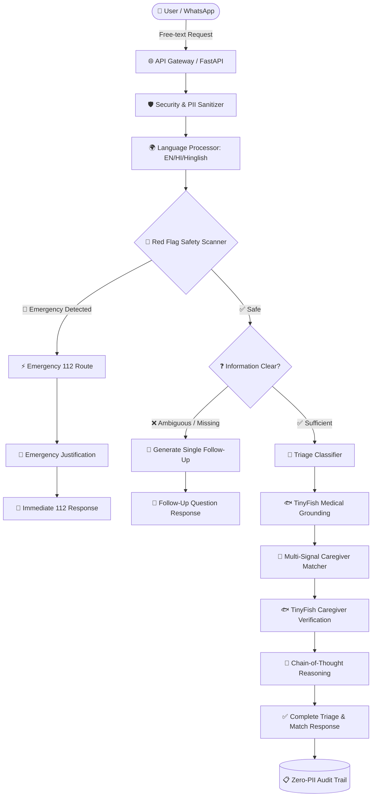

# 🧭 CareCompass AI
### *Autonomous Clinical Care-Triage & Caregiver Routing Engine*

> **"From Symptoms to Safety — In Seconds, Not Hours."**
> 
> *A Clinical Decision Support System designed for the last mile of Indian healthcare — built for safety, trust, speed, and real-time medical accountability.*

---

## 📋 Table of Contents
1. [🎤 The 60-Second Pitch](#-the-60-second-pitch)
2. [🏥 Problem Statement & Deep-Dive](#-problem-statement--deep-dive)
3. [✨ Key Features & Standout USPs](#-key-features--standout-usps)
4. [🐟 TinyFish AI Integration Strategy](#-tinyfish-ai-integration-strategy)
5. [🏗️ Solution Architecture](#️-solution-architecture)
6. [🔐 Privacy, Security & Request Handling](#-privacy-security--request-handling)
7. [📑 Exact API Contract & Usage](#-exact-api-contract--usage)
8. [📊 Dataset & Baseline Alignment](#-dataset--baseline-alignment)
9. [🚀 Getting Started & Installation](#-getting-started--installation)
10. [🧪 Testing & Verification Matrix](#-testing--verification-matrix)
11. [🗺️ Phased Implementation Plan & Commits](#️-phased-implementation-plan--commits)

---

## 🎤 The 60-Second Pitch

> *"Every year, millions of Indian families face medical distress and delay critical care because they simply do not know **who to call or where to go**. A grandmother with a deteriorating bedsore waits three agonizing days because her family didn't know a trained nurse could visit home. Conversely, an anxious father with crushing chest pain gets driven across city traffic to a small clinic instead of calling 112 for an immediate cardiac ambulance.*
>
> *Digital triage in India fails because people don't speak in medical codes — they text in conversational Hindi, English, and Hinglish. Existing chatbots make dangerous guesses, lack clinical grounding, and have zero caregiver verification.*
>
> *CareCompass AI solves this. It's a safety-first care routing engine that:*
> 1. *Understands complex multilingual health requests in Hindi, English, and Hinglish.*
> 2. *Catches 9 life-threatening red flags in **under 2 seconds** via a dual-layer safety scanner.*
> 3. *Triages requests into 5 care modalities with calibrated urgency and confidence scores.*
> 4. *Matches the optimal caregiver using real-time multi-signal allocation (distance, language, skills, rating, availability, and tier).*
> 5. *Grounds recommendations using **TinyFish AI** for real-time medical validation and doctor credential verification.*
> 6. *Explains every single decision with a human-readable clinical reasoning chain.*
>
> *CareCompass is not a chatbot. It is a high-reliability care-routing infrastructure built for life-critical healthcare."*

---

## 🏥 Problem Statement & Deep-Dive

### The Real-World Pain Points in Indian Healthcare
* **Care-Level Confusion:** Families cannot discern between teleconsultation, a home paramedic visit, specialized home nursing, or a diagnostic lab test.
* **The Hinglish Communication Gap:** Over 60% of Indian mobile health queries are framed in colloquial Hinglish (e.g., *"papa ko kal raat se chest me tightness aur dard ho raha hai"*). Standard NLP models fail on mixed-code transliteration.
* **Emergency Misidentification:** Catastrophic delays occur when heart attacks, strokes, or pediatric high fevers are mistaken for minor indigestion or common cold.
* **Caregiver Mismatch & Friction:** Sending a caregiver who doesn't speak the patient's language, is too far, or lacks specific procedural skills (e.g. IV cannulation or wound dressing) leads to failed home visits.

---

## ✨ Key Features & Standout USPs

| # | Standout USP | Why It Matters | Technical Implementation |
|---|---|---|---|
| 1 | **Dual-Layer Safety Shield** | Zero tolerance for missed emergencies. | Layer 1 deterministic keyword/regex scanner (0ms latency) + Layer 2 LLM semantic evaluator. If either detects danger → Emergency 112. |
| 2 | **Explainable AI (XAI)** | Doctors, coordinators, and families need transparent rationale. | Generates clinical chain-of-thought justifications detailing why a care type and urgency were selected. |
| 3 | **True Indic Multilingual NLU** | Handles Devanagari Hindi, Indian English, and colloquial Hinglish transliteration. | Transliteration-aware normalizer, Hindi-English synonym tokenization, and semantic embedding alignment. |
| 4 | **TinyFish Medical Knowledge Grounding** | Prevents AI hallucinations with verified medical sources. | Real-time Search and Fetch API queries pull clinical guidelines and drug interaction warnings. |
| 5 | **Real-Time Caregiver Verification** | Protects patient safety against fraudulent or unlicensed providers. | TinyFish Agent API verifies doctor and paramedic registration numbers against official medical council registries. |
| 6 | **Adaptive Confidence & Follow-Up Engine** | Avoids reckless guesses when information is ambiguous. | Computes decision entropy; if confidence drops below threshold, triggers exactly one targeted follow-up question. |
| 7 | **Multi-Signal Allocation Engine** | Optimizes clinical outcome, proximity, and patient comfort. | Weighted blend: Language Match (25%), Distance via Haversine (25%), Skill Overlap (20%), Rating (10%), Availability Window (10%), Experience/Tier (10%). |
| 8 | **Privacy-by-Design & Zero PII Logging** | Healthcare privacy compliance (HIPAA / DISHA principles). | Immediate one-way hashing of patient input and coordinates in audit logs; ephemeral session storage. |

---

## 🐟 TinyFish AI Integration Strategy

We harness **TinyFish's suite of APIs** to provide real-time clinical grounding and trust:

```
┌────────────────────────────────────────────────────────┐
│                   TinyFish AI APIs                     │
├───────────────────┬────────────────────────────────────┤
│ API Type          │ Clinical Role in CareCompass AI    │
├───────────────────┼────────────────────────────────────┤
│ 1. Search API     │ • Validates triage criteria        │
│    (FREE Tier)    │ • Fetches first-aid guidance       │
│                   │ • Checks drug-drug interactions    │
├───────────────────┼────────────────────────────────────┤
│ 2. Fetch API      │ • Extracts clean clinical data     │
│    (FREE Tier)    │ • Ingests ICMR / WHO protocols     │
│                   │ • No HTML bloat; token-efficient   │
├───────────────────┼────────────────────────────────────┤
│ 3. Agent API      │ • Verifies caregiver registrations │
│    ($0.016/step)  │ • Verifies NMC/nursing credentials │
│                   │ • Live hospital bed availability   │
└───────────────────┴────────────────────────────────────┘
```

---

## 🏗️ Solution Architecture



---

## 🔐 Privacy, Security & Request Handling

* **Zero PII Storage:** Raw symptom descriptions and exact GPS coordinates are hashed using SHA-256 before writing to immutable audit logs.
* **Prompt Injection Defense:** Dedicated sanitizer cleans HTML/script tags and rejects prompt injection jailbreaks (`ignore previous instructions`, `system prompt override`).
* **Strict Rate Limiting:** Built-in IP rate limiter (100 req/min/IP) prevents denial-of-service on triage endpoints.
* **Regional Validation:** Enforces strict boundary checks for coordinates within Delhi NCR (Lat 27.5–29.5, Lng 76.0–78.5).

---

## 📑 Exact API Contract & Usage

### 1. Triage Request (`POST /api/v1/triage`)
```json
{
  "user_input": "papa ko do din se bukhar hai aur khansi bhi",
  "language": "auto",
  "location": {
    "lat": 28.54,
    "lng": 77.27
  },
  "conversation_history": []
}
```

### 2. Triage Response — Care Decision (`200 OK`)
```json
{
  "follow_up_question": null,
  "care_type": "paramedic_home_visit",
  "urgency": "same_day",
  "red_flags": [],
  "reasoning": "Fever with cough for 2 days without red-flag symptoms. In-person paramedic assessment recommended.",
  "matched_caregivers": [
    {
      "caregiver_id": "CG_014",
      "score": 0.94,
      "reason": "Hindi-speaking Medic, 3.1 km away, certified in vitals & IM injection, free at 16:00."
    }
  ],
  "confidence": 0.92,
  "detected_language": "Hinglish",
  "medical_context": "Viral fever with cough guidelines: monitor temperature, maintain hydration."
}
```

### 3. Triage Response — Emergency Case (`200 OK`)
```json
{
  "follow_up_question": null,
  "care_type": "emergency_112",
  "urgency": "emergency",
  "red_flags": ["chest_pain", "breathlessness"],
  "reasoning": "Red-flag symptoms detected (chest pain, breathlessness). Routed immediately to emergency services.",
  "matched_caregivers": [],
  "confidence": 1.0,
  "detected_language": "Hinglish",
  "medical_context": "CRITICAL EMERGENCY: Call 112 immediately. Keep patient seated and calm."
}
```

---

## 📊 Dataset & Baseline Alignment

CareCompass AI is calibrated against the synthetic benchmark dataset:
* **`triage_dataset.jsonl`**: 340 structured triage examples (103 Home Nursing, 56 Emergency 112, 51 Home Lab, 48 Teleconsultation, 43 Paramedic Visit, 39 Follow-up).
* **`caregivers.csv`**: 60 active and reserve healthcare providers (Medics, Doctors, Phlebotomists).
* **Multi-Language Distribution**: 130 English, 113 Hinglish, 97 Hindi.

---

## 🚀 Getting Started & Installation

### Option A: Local Python Setup
```bash
# 1. Clone repository
git clone https://github.com/ErenSnowh/CareCompassIntelligence.git
cd CareCompassIntelligence

# 2. Setup Virtual Environment
python -m venv .venv
source .venv/bin/activate  # On Windows: .venv\Scripts\activate

# 3. Install Dependencies
pip install -r backend/requirements.txt

# 4. Configure Environment
cp backend/.env.example backend/.env

# 5. Run FastAPI Server
cd backend
uvicorn app.main:app --reload --port 8000
```
Interactive API documentation is accessible at `http://localhost:8000/docs`.

### Option B: Docker Compose
```bash
docker-compose up --build
```

---

## 🧪 Testing & Verification Matrix

Run the automated test suite with pytest:
```bash
python -m pytest backend/tests -v
```

Test coverage targets:
- `test_data_loader.py`: Verifies loading and schema validation across 340 triage rows and 60 caregivers.
- `test_preprocessor.py`: Tests language detection across Hindi, English, and Hinglish.
- `test_api.py`: Validates FastAPI endpoints, red flag immediate escalation, and caregiver directory queries.
- `test_config.py`: Verifies application configuration parameters and security limits.

---

## 🗺️ Phased Implementation Plan & Commits

| Phase | Milestone | Deliverable | Git Commit Message |
|:---:|:---|:---|:---|
| **Phase 1** | Foundation & Pipeline | Project scaffold, data loader, schemas, and FastAPI entry | `feat: Phase 1 — project scaffold, data pipeline, and foundation API` |
| **Phase 2** | Safety-First Core | Dual-layer Red Flag Detector (High-recall rules + semantics) | `feat: Phase 2 — red flag detector with dual-layer safety scanner` |
| **Phase 3** | Intelligence & Triage | Multilingual NLU, classifier, confidence & follow-up engine | `feat: Phase 3 — triage classifier with confidence scoring and follow-up engine` |
| **Phase 4** | Matching Engine | Multi-signal caregiver matching with geo-distance and tier weights | `feat: Phase 4 — multi-signal caregiver matching and ranking engine` |
| **Phase 5** | Integration & Grounding | End-to-end API, TinyFish Search/Fetch/Agent integration | `feat: Phase 5 — complete API contract, TinyFish integration, and reasoning engine` |
| **Phase 6** | Modern Frontend UI | Patient WhatsApp-style chat UI + Admin Analytics Dashboard | `feat: Phase 6 — interactive web application and live dashboard` |
| **Phase 7** | Hardening & Polish | Comprehensive test suites, security hardening, and final docs | `feat: Phase 7 — complete test suite, security hardening, and documentation` |

---

### 📄 License
Synthetic hackathon project developed for Sanocare Healthcare Triage Innovation Challenge.
