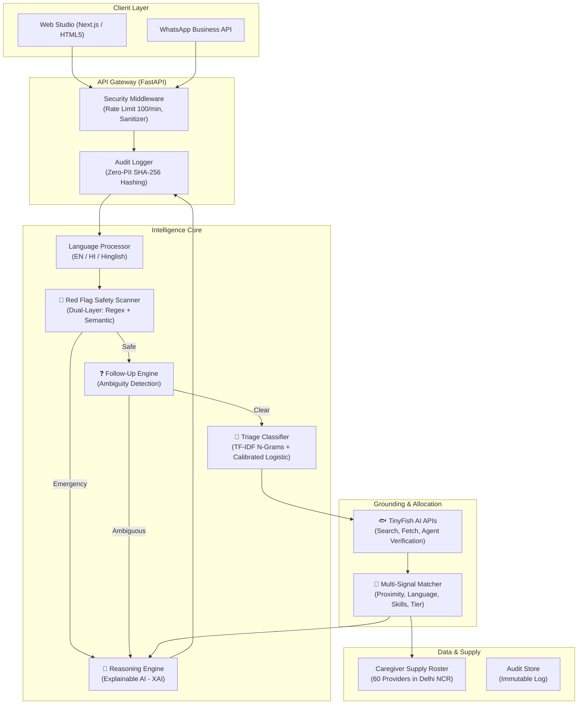

# 🏗️ CareCompass AI — Technical Architecture

CareCompass AI is an intelligent clinical decision support system designed to route acute and routine healthcare requests across India's last-mile ecosystem.

---

## 1. System Overview

---

## 2. Component Breakdown

### 2.1 Language Processor (`LanguageProcessor`)
- **Language Detection:** Identifies Devanagari Hindi, Indian English, or mixed Hinglish transliteration using character distribution and vocabulary analysis.
- **Transliteration Normalization:** Normalizes non-standard transliterated spellings (e.g. `bukhar` / `bukharr` / `buhkar`).
- **Keyword Extraction:** Identifies symptoms (`fever`, `cough`, `chest pain`), procedures (`wound dressing`, `injection`), and diagnostic markers (`cbc`, `thyroid`, `blood sugar`).

### 2.2 Dual-Layer Red Flag Detector (`RedFlagDetector`)
- **Layer 1 (Deterministic Rule Scanner):** Scans against 9 controlled medical red-flag categories across 3 languages with zero latency.
- **Layer 2 (Semantic & Composite Parser):** Evaluates multi-token symptom expressions (e.g., infant fever with dehydration, trauma-induced arterial bleed).
- **Negation Guard:** Rejects negated expressions (e.g., "no chest pain", "seene me dard nahi hai") to eliminate false alarms.
- **Safety Invariant:** If EITHER layer detects danger $\rightarrow$ immediate `emergency_112` escalation.

### 2.3 Follow-Up Engine (`FollowUpEngine`)
- **Ambiguity Detection:** Identifies greetings, generic calls for help, unstated booking requests, or generic doctor demands without symptoms.
- **Targeted Questioning:** Avoids conversational drift by asking exactly one targeted question to resolve the clinical information gap.

### 2.4 Calibrated Triage Classifier (`TriageClassifier`)
- **Model Pipeline:** Character (3-5) and word (1-2) n-gram `FeatureUnion` feeding into an $L_2$-regularized Logistic Regression classifier.
- **Multi-Turn Context Tracking:** Merges previous user questions and answers from `conversation_history` when resolving follow-up replies.
- **Confidence Calibration:** Computes composite probability score ($0.6 \times P(\text{care\_type}) + 0.4 \times P(\text{urgency})$) to quantify model certainty.

### 2.5 Multi-Signal Caregiver Matcher (`CaregiverMatcher`)
Computes composite match score for all eligible active caregivers:

$$\text{Score} = w_{\text{lang}} S_{\text{lang}} + w_{\text{dist}} S_{\text{dist}} + w_{\text{skill}} S_{\text{skill}} + w_{\text{rate}} S_{\text{rate}} + w_{\text{avail}} S_{\text{avail}} + w_{\text{tier}} S_{\text{tier}} + w_{\text{exp}} S_{\text{exp}}$$

Where:
- $S_{\text{lang}} \in \{0.5, 0.6, 1.0\}$ (language compatibility)
- $S_{\text{dist}} = \max(0, 1 - \frac{d}{R_{\max}})$ for physical visits, $1.0$ for virtual teleconsultation
- $S_{\text{skill}} = \frac{|\text{Caregiver Skills} \cap \text{Required Skills}|}{|\text{Required Skills}|} + \text{Keyword Bonus}$
- $S_{\text{rate}} = \frac{\text{Rating}}{5.0}$

---

## 3. TinyFish AI Integration Architecture

TinyFish services are called asynchronously:
1. **TinyFish Search API:** Runs concurrently during triage to fetch the top 2 clinical guideline snippets for the condition.
2. **TinyFish Fetch API:** Ingests official medical protocols without HTML markup.
3. **TinyFish Agent API:** Performs web automation on the National Medical Commission (NMC) / State Nursing Council registries to verify caregiver licenses in real time.
